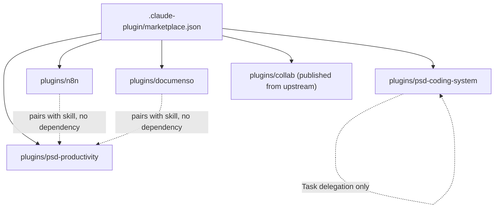

# Marketplace structure, versioning and release rules

This repo is the **PSD Plugin Marketplace** for Claude Code and Claude Cowork, maintained by Peninsula School District. It is almost entirely Markdown/JSON/shell configuration that Claude Code reads directly (no build step; skills hot-reload). Authoritative guidance lives in [`/CLAUDE.md`](../../CLAUDE.md); this page condenses the structural rules.

## The five plugins

`.claude-plugin/marketplace.json` (`metadata.pluginRoot: ./plugins`) lists five independently installable plugins:

| Plugin | What it is | Wiki page |
|---|---|---|
| `psd-coding-system` | 9 skills (`/plan`, `/lfg`, `/evolve`, `/setup`, `/worktree`, `/bump-version`, `/psd-sign`, `/chad-review`, `/hallmark`), 44 agents, hooks, scripts | [coding-system](./coding-system.md) |
| `psd-productivity` | 33 skills + 1 agent (`enrollment-validator`), Cowork-friendly | [productivity-plugin](./productivity-plugin.md) |
| `n8n`, `documenso` | Opt-in MCP connections (`defaultEnabled: false`) | [mcp-plugins](../integrations/mcp-plugins.md) |
| `collab` | Hooks plus hosted MCP server for threads between colleagues' agents | [collab-plugin](../integrations/collab-plugin.md) |

*Plugins are leaf directories; relationships between them are conventions, never declared dependencies.*

## Invariants

- **marketplace.json is critical.** `plugins[]` must match the real directory tree; every `source` must exist; versions should match each `plugin.json`. When structure changes, update marketplace.json first.
- **Plugin independence.** Plugins cannot declare dependencies on each other; skills cannot invoke other skills (workflows chain through Task delegation to agents); each plugin ships its own agents. The `n8n`/`documenso` plugins only *pair* with `/n8n-manager` / `/documenso-manager` in productivity.
- **Third-party catalog entries are SHA-pinned.** A `marketplace.json` entry whose `source` is an object of type `github`, `url` or `git-subdir` must carry `sha` as a full 40-character lowercase commit SHA; relative-path sources (`./plugins/...`) are exempt. CI enforces this with [`ci/check-marketplace-pins.js`](../operations/ci-and-automation.md#what-ci-actually-runs-psd-ciyml). The current catalog has only relative-path sources, so the check passes trivially today.
- **`hooks.json` shape.** Hooks must be nested in a `"hooks"` array inside each event entry (see [coding-system hooks](./coding-system.md#hooks)).
- **`collab` is not developed here.** `plugins/collab/.publish-source` records `psd401/psd-collab-mcp`; fix upstream and re-publish. Never hand-edit it, and `/bump-version` ignores it.
- **Agent/skill frontmatter pins `model:` and `effort:` explicitly.** Model-pinned skills use `claude-opus-5-5` (`effort: high`; `xhigh` for `/evolve`); `/plan` uses `claude-fable-5-1` at `xhigh`; `/lfg` runs `claude-opus-5-5` at `medium`; agents default to `claude-sonnet-5` except architect-specialist, meta-reviewer, runtime-verifier, plan-validator (Opus). Bare aliases only, never date-suffixed IDs. Pinning `effort` exists so a model-default shift cannot silently change quality. Skills without `model:` inherit the session.

## Version tracks (never mix)

| Track | Bump locations | When |
|---|---|---|
| Marketplace | `marketplace.json` `metadata.version`; `CLAUDE.md` `**Version**`; `README.md` badge/text | every release |
| psd-coding-system | its `plugin.json`, marketplace entry, `plugins/psd-coding-system/README.md` | only when its skills/agents change |
| psd-productivity | same pattern | only when its skills/agents change |
| n8n, documenso | each `plugin.json` + marketplace entry | only when that plugin's proxy/server changes |

Run the `/bump-version` skill (`plugins/psd-coding-system/skills/bump-version/SKILL.md`) rather than enumerating files by hand. It starts from an up-to-date `main`, works on a `chore/bump-<timestamp>` branch, and lands via PR (`main` requires a PR, 0 approvals). Two non-negotiables: run `claude plugin validate .` before tagging, and tag with plain `git tag -a vX.Y.Z` — **never** `claude plugin tag` (it creates per-plugin `{name}--v{version}` tags that do not match this repo's marketplace-wide tags).

## Change navigation

| Intent | Start | Check |
|---|---|---|
| Add/remove a plugin | `.claude-plugin/marketplace.json`, new `plugins/<name>/.claude-plugin/plugin.json` | `claude plugin validate .`; `jq '.plugins[].name' .claude-plugin/marketplace.json` |
| Change skill/agent counts in docs | `CLAUDE.md`, `README.md`, plugin READMEs, `plugin.json` description, marketplace entry | grep the old count; counts live in all of these |
| Release | `/bump-version` | `claude plugin validate .` |
| Add a third-party plugin source | `.claude-plugin/marketplace.json` `plugins[].source` | `sha` present and 40-char lowercase; `bun ci/check-marketplace-pins.js` |

Stale-doc warning: `docs/META_LEARNING_GUIDE.md` (v1.9.0) still describes removed `/work`, `/test`, `/review_pr`, `/clean_branch` commands; and `plugins/psd-coding-system/docs/agent-manifest.md` lists several agents as "orphans" that `/lfg` Phase 6 and `/setup`'s `review_agents` config now do wire in. Prefer the skill sources. See also [CI and repo automation](../operations/ci-and-automation.md) for what actually validates PRs.
actually validates PRs.
nch` commands; and `plugins/psd-coding-system/docs/agent-manifest.md` lists several agents as "orphans" that `/lfg` Phase 6 and `/setup`'s `review_agents` config now do wire in. Prefer the skill sources. See also [CI and repo automation](../operations/ci-and-automation.md) for what actually validates PRs.
