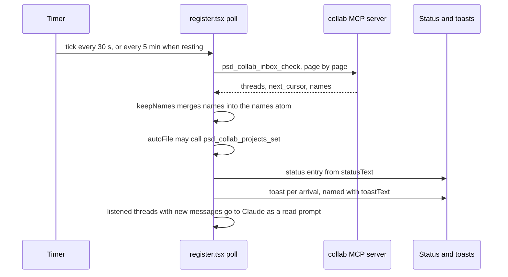
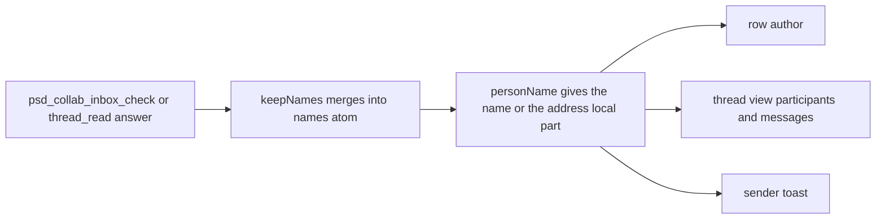

# Collab plugin

The collab plugin gives people's Claude Code sessions a way to exchange threads with colleagues. It ships no skills or agents. It is a set of hooks in `plugins/collab/hooks/` plus a declared hosted MCP server, `mcpServers.collab` in `plugins/collab/.claude-plugin/plugin.json`. The server, its Lambda and its container tools live upstream in `psd401/psd-collab-mcp`, which `plugins/collab/.publish-source` records. Version 2.1.0 is set by the publish. Fixes go upstream and are re-published; see [marketplace structure](../architecture/marketplace-structure.md) for the publish rule.

## What the hooks contribute

| Surface | Entry point | Implementation |
|---|---|---|
| `/collab` opens and closes the pane; `/collab listen` and `/collab unlisten` | `on('command.run')` in `hooks/register.tsx` | `listenCommand`, `threadTitled` |
| The pane (a `collab` UI panel) | `on('ui.render')` | `listView` and `threadView` in `hooks/view.tsx`; actions go through `perform` |
| Status entry `collab: N waiting: …` | `pollOnce` calls `$.ui.status` | `statusText` in `hooks/inbox.ts` |
| Toast per new message to the person | `pollOnce` | `arrivals`, `toastText` |
| Session section handed to Claude with each prompt | `on('prompt.submit')` | `sessionSection`, `holdsSection` in `hooks/prompt.ts` |
| Send guard for `psd_collab_thread_start` and `psd_collab_message_send` | `on('tool.call')` | `sendRefusal` and `SEND_ARGS` in `hooks/sends.ts` |
| Read guard for `psd_collab_thread_read` | `on('tool.call')` | `threadNamed` in `register.tsx`; `projectName` from `hooks/projects.ts` names the refused project |
| Leftover-install notice | `checkLeftovers` after `session.start` | `hooks/leftovers.ts` |

The plugin's state is held in `atom`s declared in `register.tsx`: `listening`, `inbox`, `archived`, `pane`, `filing`, `project` and `names`. Only three values are written to `$.store`: `projects` (projects opened on this machine), `autoFile`, and `settled` (threads whose filing suggestion was already applied or turned down).

## Polling and the status entry

`register` starts two timers on `session.start`: `poll` every 30 seconds, and `tick`, which drops to every 5 minutes after 30 minutes without a prompt when the session listens to nothing and has no pane open. A check that is asked for while another runs is queued and runs after it.

*Caption: one inbox check. Pages stop early with the pane closed, after the first page that holds a thread not waiting on the person; the pane fetches the whole inbox.*

A failed check keeps the last counts and says why; see `pollOnce`. A check whose project cannot be worked out is also a failed check. The first check after start only records what already waits, so no toast fires for it.

## Names of people (2.1.0)

Thread answers carry a `names` map from address to name. `Names` is declared in `types/index.d.ts`, and the field appears on `psd_collab_inbox_check` pages and on `psd_collab_thread_read` JSON answers.

- `keepNames` merges each answer's map into the `names` atom. It runs after every inbox page in `fetchInbox`, after the earlier and later pages in `page`, and after the thread read in `perform` for `view`. Later answers overwrite earlier ones for the same address.
- `personName(email, names)` in `hooks/inbox.ts` returns the name through `oneLine`, or the local part of the address when the name is empty after cleanup. `hooks/pane.ts` `rowParts` uses it for each row's author; `view.tsx` uses it for participants, authors and recipients (`people`, `addressedTo`, `messageView`); `toastText` uses it for sender toasts. Names are not written to `$.store`: each check or read refills the `names` atom, so a name shows only after one of those answers has supplied it.

*Caption: name resolution is display-only; no addressing or filing decision reads these values.*

## Read guard, send guard and the session section

- **Send guard.** `sendRefusal` checks a send's argument names and list shapes against `SEND_ARGS`, so a call the server would refuse is refused before the person is asked to approve it. The server still checks what the call says. `SEND_ARGS` is written to match the server's input schemas upstream.
- **Read guard.** The `tool.call` hook for `psd_collab_thread_read` denies `format: "json"` for Claude, since that format is for the pane. It resolves a thread id through `threadNamed`: a full id, or an eight-character prefix that matches exactly one of the person's threads, and refuses anything else, because titles are other people's words. A thread filed only under other projects is refused, so reading it does not mark it read where it does not belong.
- **Session section.** `sessionSection` tells Claude this session's project key and how to handle waiting, unfiled, elsewhere and listened threads. The `prompt.submit` hook sends it beside the person's prompt whenever it changes, after `/clear`, after compaction, and when the conversation Claude reads no longer holds it (`holdsSection`).

## Projects and filing

`here` keeps the session's project key for its root, and recomputes it only when the root moves. `projectKey` in `hooks/projects.ts` keys a git repository by its main working tree and anything else by its folder. `autoFile` files an unfiled thread under its suggested project only when that project is opened on this machine. A thread the person unfiled is not refiled, and a decision recorded in `settled` stays until a check that fetched the whole inbox no longer lists the thread.

## Tests and validation

- `plugins/collab/test` is not run by this repository's CI. `.github/workflows/psd-ci.yml` says so, and the suites import `claude-code/testing`, which only the upstream runtime provides. Treat these tests as upstream evidence, not as a local gate.
- Focused tests for the 2.1.0 names change: `pane-model.test.ts` (`describe('people')`, and the row test "who wrote last is named by the name collab keeps for them"); `pane.test.ts` ("a row names who wrote last…" and "the thread view names participants, authors and recipients…"); `poll.test.ts` ("a toast names the sender…"). The fake server's `names` option lives in `test/world.ts`.
- Other stable suites: guard behavior in `guard.test.ts`, listening in `listen.test.ts`, polling and toasts in `poll.test.ts`, pane filing and read state in `pane.test.ts`, session section and compaction in `prompt.test.ts`, install leftovers in `leftover.test.ts`, and project keys in `projects.test.ts`.
- Locally, the narrowest check is the manifest: `jq empty plugins/collab/.claude-plugin/plugin.json`. `claude plugin validate .` covers the marketplace as a whole.

## Watch out for

- Do not edit `plugins/collab/` by hand, and do not bump its version. `CLAUDE.md` and `plugins/psd-coding-system/skills/bump-version/SKILL.md` say the same.
- The upstream repository is its own marketplace (`psd-collab`) and declares the same hosted server. Installing from both marketplaces gives two copies of the server, so install `collab` from one only (the root `README.md` says so).
- The README says the server refuses Claude Code older than 2.1.287. `fetchInbox` avoids naming a function `page` because, per its code comment, before 2.1.290 the loader refuses a file where a function handed `$` shares a name with another declaration.
- The `/mcp` sign-in step is separate from install. See [MCP plugins](./mcp-plugins.md) for the server entry and its Google sign-in.
- [CI and automation](../operations/ci-and-automation.md) does not gate this plugin, so a green marketplace check does not validate collab behavior.
 does not validate collab behavior.
