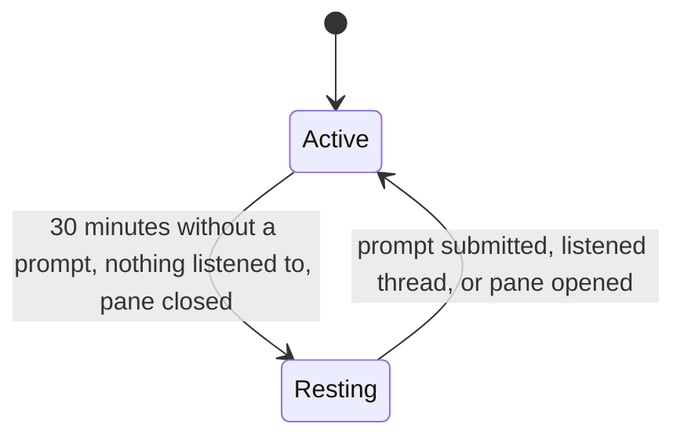
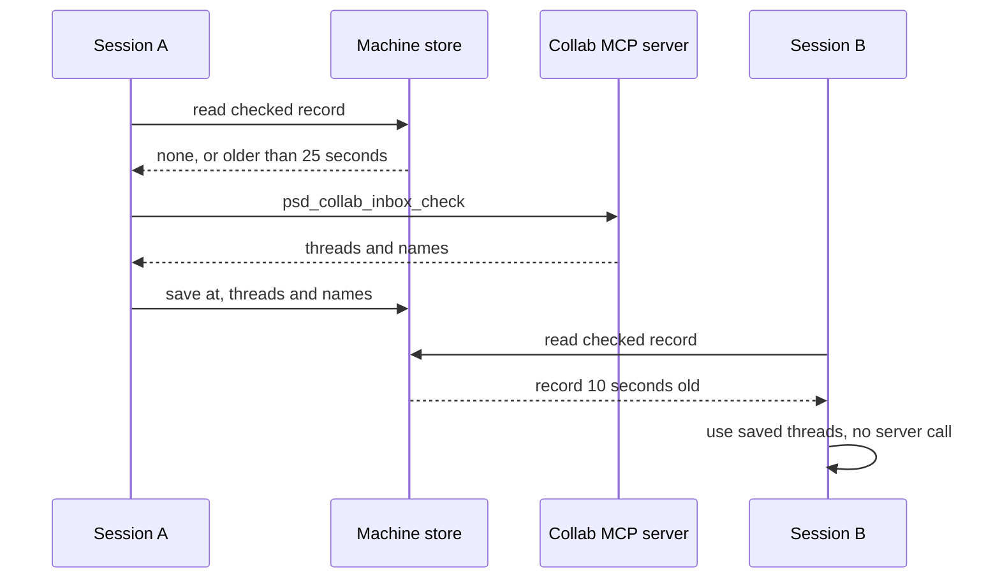

# Collab plugin

The collab plugin is the Claude Code side of threads between colleagues' agents. It is a hooks-only plugin: `plugins/collab/hooks/hooks.json` loads a single module, `./register.tsx`, which registers session hooks, tool guards, a `/collab` command, and a pane UI. The threads themselves live on the hosted collab MCP server that `plugin.json` declares (`mcpServers.collab`, type `http`). Since 2.4.0 that entry also sends an `X-Collab-Plugin-Version` header whose value matches the plugin version; the manifest is the only place in this repository that declares it, and what the server does with it is defined upstream. The plugin is published from upstream `psd401/psd-collab-mcp` (`plugins/collab/.publish-source`) and must not be hand-edited here.

## Components

| Module | Responsibility |
|---|---|
| `hooks/register.tsx` | Single registration point: `session.start` timers, `tool.call` guards, `command.run` for `/collab`, `ui.render` for the pane, `prompt.submit` for the session section. Owns all polling state. |
| `hooks/inbox.ts` | Pure helpers: `statusText`, `arrivals`, `isReadableHere`, `unclaimed`/`claimed` (notification claims), `threadsTitled`, `listenPrompt`, `isOwnPollNotice`, and `sharedCheckOf` (validates the shared-check record). |
| `hooks/view.tsx`, `hooks/pane.ts` | Draw the pane (list by project, one thread's messages) and produce `Action` values the hooks carry out. |
| `hooks/prompt.ts` | The session section Claude receives: this session's project and how to treat threads filed here, unfiled, or elsewhere. |
| `hooks/sends.ts` | Checks `psd_collab_thread_start` and `psd_collab_message_send` arguments before the permission prompt. |
| `hooks/projects.ts`, `hooks/server.ts`, `hooks/leftovers.ts` | Project keys, reading server answers, and detecting the old server entry, old status line, or a second install. |
| `types/index.d.ts` | The state contract: `Thread`, `Names`, `Inbox`, `ThreadRead`, `PaneView`, `Filing`, declared under `PluginState.collab`. |

## Polling model

Each session runs its own timer. `session.start` sets the last-prompt and last-check clocks, runs one check, and registers `$.clock.every(POLL_MS, tick)` with `POLL_MS` of 30 seconds. `tick` sets the session to *resting* when there has been no prompt for 30 minutes (`QUIET_AFTER_MS`), nothing is listened to, and the pane is closed. A resting session asks the server only every 5 minutes (`QUIET_POLL_MS`). A prompt, a listened-to thread, or an open pane brings it back to normal polling.



Caption: how a session moves between normal polling and the quiet 5-minute cadence.

## Shared checks between sessions (2.3.0)

Before 2.3.0, every open session asked the server on its own, and one person with many sessions could hit the server's rate limit. Version 2.3.0 has sessions on one machine share their results through `$.store`, under the key `checked`:

- After a check that asked the server, `pollOnce` saves `{ at, threads, names }` under `checked`, where `at` is the time the request began.
- `usableSharedCheck` returns that record only when it is at least 0 and less than `SHARED_FRESH_MS` (25 seconds) old, or less than `QUIET_POLL_MS` old while resting. `sharedCheckOf` rejects a malformed record (non-numeric `at`, non-array `threads`, non-object `names`), and the caller then asks the server.
- `pollOnce` uses the shared record only when the check is not whole (`isWhole` false). It merges the record's names and skips the server call. It does not save a record again, so the check time stays that of the session that asked.
- A failed check saves nothing. `askedAt` is set before the fetch and the save happens after `autoFile`, so an error leaves the last good record for the others.



Caption: a session that finds a fresh shared check reuses it instead of calling the server.

Full-inbox checks never use the shared record. `poll(…, isWhole)` is set by `refresh` (after any pane action), by `command.run` before the pane opens, and by `isPaneOpen`, which fetches every page instead of stopping at the first non-waiting thread.

## Inbox checks and notifications

- `fetchInbox` pages through `psd_collab_inbox_check`. With the pane closed (`isWaitingEnough`), it stops at the first page holding a thread not waiting on the person, because waiting threads come first.
- `arrivals` compares `unread_to_you` with the previous check to find new messages. Each one raises a toast (`toastText`). The first check raises none.
- `notifyArrivals` raises one native notification per machine. Sessions claim threads in `notified` (`claimed`/`unclaimed`, keyed by `last_activity`), so a notification is never repeated. Notifications never carry thread titles.
- `statusText` builds the status entry, such as `4 waiting: 1 here · 1 lunch-menu · 1 unfiled`.

## Filing and projects

`here` maps the session root to a project key with `projectKey`, caching it until the root changes. `autoFile` files unfiled threads under their suggested project only when auto-filing is on, the project is known on this machine (`projects`), and that suggestion has not been settled before (`settled`). A thread the person unfiled stays unfiled until a different project is suggested.

## Listening and sends

- `/collab listen [title]` adds a thread to `listening`. Replies in listened threads are handed to Claude via `listenPrompt`, which names threads by id only, because titles are other people's words. A thread filed only elsewhere is not handed over (`isReadableHere`).
- A send hook (`tool.call` on `psd_collab_thread_start` and `psd_collab_message_send`) first runs `sendRefusal`, then adds `sent_from` from the session project. After a successful send, `noteSend` sets `lastSent` and shows a `sentToast` unless the thread is already listened to.

## Read guard and session context

The `tool.call` guard on `psd_collab_thread_read` denies `format: "json"` (reserved for the pane) and reads of a thread filed only under other projects. `threadNamed` resolves a full id, or an eight-character short id that must match exactly one of the person's threads. The `prompt.submit` hook adds the session section beside the person's prompt, and resends it after `/clear` or compaction, or when it is missing from the conversation (`holdsSection`).

## Tests

Tests run in the upstream `claude-code/testing` runtime: `world.ts` provides a session, a clock mock, and an in-memory collab server that answers `psd_collab_inbox_check`. `ci/` does not run them (see [CI and automation](../operations/ci-and-automation.md)).

Behavior matrix for the shared check, all in `plugins/collab/test/poll.test.ts`:

| Invariant | Test name (search `test/poll.test.ts`) |
|---|---|
| A check saves `{ at, threads, names }` | `a check saves what it found for the other sessions on this machine` |
| A record under 25 seconds old is used, no server call | `a check uses what another session found under 25 seconds ago instead of asking the server` |
| A record 25 seconds old or more is ignored | `what another session found 25 seconds ago or more is checked again` |
| A new message in a shared record raises a toast with the sender | `a new message another session found raises a toast here too, naming the sender` |
| A resting session uses the shared record each 30 seconds and asks the server every 5 minutes | `a quiet session uses what others found every 30 seconds, and asks the server only every 5 minutes` |
| A failed check does not overwrite the record | `a failed check saves nothing, leaving the last good check for the other sessions` |
| Malformed records are ignored (describe block) | `what the store holds under the shared check is not used when it has` (four cases) |

Other poll behavior: `the inbox is checked every 30 seconds`, `after 30 minutes with no prompt, the inbox is checked every 5 minutes`, `a prompt after a quiet spell checks the inbox at once, then every 30 seconds again`, and `with the pane closed, a check stops at the first page holding a thread not waiting on the person`. Pane actions re-check the inbox: `each action checks the inbox again so the pane shows the result` in `plugins/collab/test/pane.test.ts`. Other files cover the read guard (`guard.test.ts`), listening (`listen.test.ts`), notifications (`notify.test.ts`), dropped task notices (`notice.test.ts`), the session section (`prompt.test.ts`), and projects (`projects.test.ts`).

## Change navigation

- **Polling cadence, shared checks, or resting logic:** start in `register.tsx` at `usableSharedCheck`, `pollOnce`, `poll`, and `tick`. Add a poll-test case next to the shared-check tests before changing a constant. `SHARED_FRESH_MS`, `QUIET_POLL_MS`, and `QUIET_AFTER_MS` are constants shared by all sessions on a machine.
- **Pure text, status, or notification wording:** change `inbox.ts` (`statusText`, `toastText`, `notifyText`) and the matching tests in `poll.test.ts` or `notify.test.ts`.
- **Pane behavior:** `view.tsx` draws, `perform` in `register.tsx` carries out actions, and `pane.test.ts` covers them.
- **Anything that changes the server contract:** fix upstream `psd401/psd-collab-mcp`, then republish. The contract types live in `types/index.d.ts`.

Validation here is limited. The plugin's tests import `claude-code/testing`, a runtime this repository does not provide (there is no `package.json` under `plugins/collab`), and CI does not run `plugins/collab/test`. Check manifest consistency locally:

```bash
jq -r .version plugins/collab/.claude-plugin/plugin.json
jq -r '.plugins[] | select(.name=="collab") | .version' .claude-plugin/marketplace.json
jq -r '.mcpServers.collab.headers["X-Collab-Plugin-Version"]' plugins/collab/.claude-plugin/plugin.json
```

The first two must print the same version (`2.4.0` at the last publish), and the header must print that version too, as the 2.4.0 publish set all three together. Run the upstream test suites only after a change to the plugin source is made in `psd401/psd-collab-mcp`.

## Related

- [Marketplace structure](../architecture/marketplace-structure.md) describes the publish rule and version bumping for published plugins.
- [MCP plugins](./mcp-plugins.md) covers the same hosted-server pattern for n8n and documenso, which use proxy scripts rather than hooks.
- [CI and automation](../operations/ci-and-automation.md) explains why `plugins/collab/test` is not part of the test gate.
