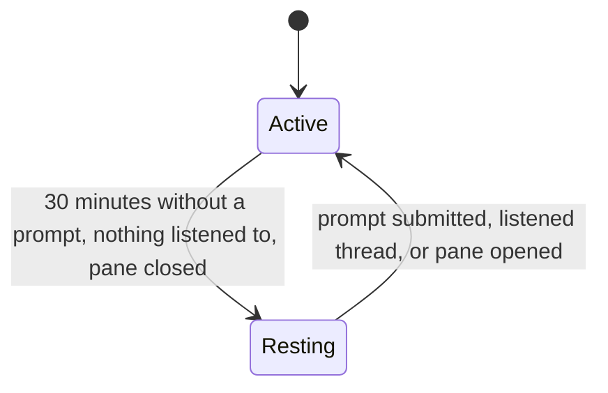
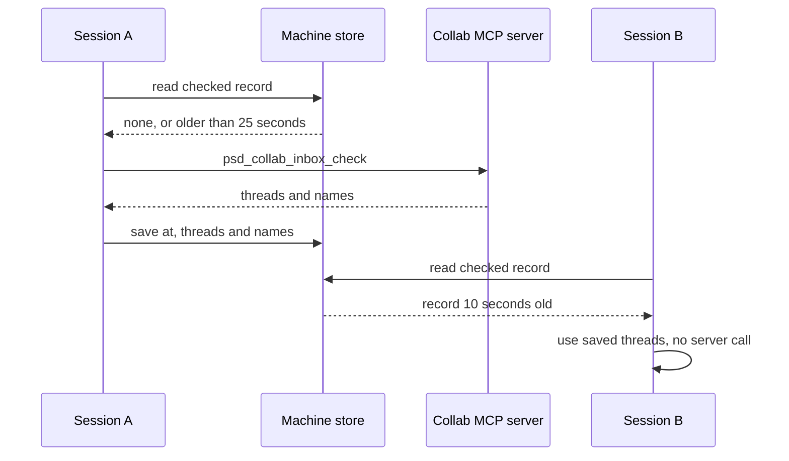
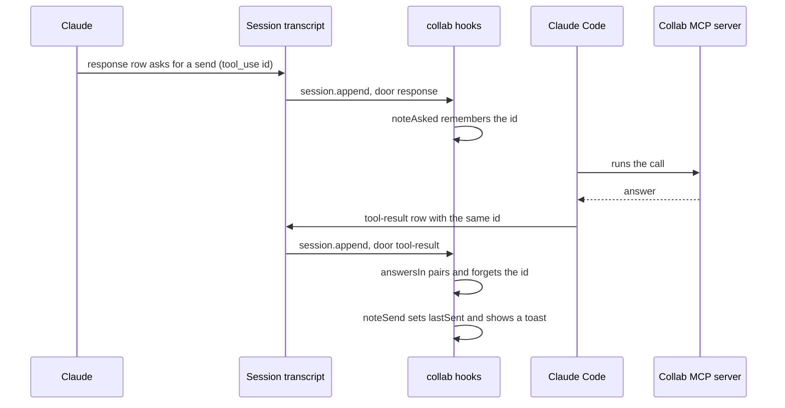

# Collab plugin

The collab plugin is the Claude Code side of threads between colleagues' agents. It is a hooks-only plugin: `plugins/collab/hooks/hooks.json` loads a single module, `./register.tsx`, which registers session hooks, transcript observers for Claude's collab calls, a `/collab` command, and a pane UI. The threads themselves live on the hosted collab MCP server that `plugin.json` declares (`mcpServers.collab`, type `http`, URL only). The plugin's version reaches the server as a `plugin_version` argument on inbox checks and pane reads, not as an HTTP header: 2.4.0 sent an `X-Collab-Plugin-Version` header from the manifest, and 2.5.0 removed that header and moved the signal into the tool call (see [Plugin version on calls](#plugin-version-on-calls-250)). What the server does with the version and with `read_from` is defined upstream. The plugin is published from upstream `psd401/psd-collab-mcp` (`plugins/collab/.publish-source`) and must not be hand-edited here.

## Components

| Module | Responsibility |
|---|---|
| `hooks/register.tsx` | Single registration point: `session.start` timers, `session.append` observers of Claude's send, inbox-check and tool-result rows, `command.run` for `/collab`, `ui.render` for the pane, `prompt.submit` for the session section. Owns all polling state. |
| `hooks/inbox.ts` | Pure helpers: `statusText`, `arrivals`, `isReadableHere`, `unclaimed`/`claimed` (notification claims), `threadsTitled`, `listenPrompt`, `isOwnPollNotice`, `backgroundTask`, and `sharedCheckOf` (validates the shared-check record). |
| `hooks/view.tsx`, `hooks/pane.ts` | Draw the pane (list by project, one thread's messages) and produce `Action` values the hooks carry out. `pane.ts`'s `untagged` takes the server's untrusted-data tags off a pane read. |
| `hooks/prompt.ts` | The session section Claude receives: this session's project, the `sent_from` and `read_from` value to pass, and how to treat threads filed here, unfiled, or elsewhere. |
| `hooks/projects.ts`, `hooks/server.ts`, `hooks/leftovers.ts` | Project keys, reading server answers (`answerOf`, and `resultText` for a transcript's tool-result content), and detecting the old server entry, old status line, or a second install. |
| `types/index.d.ts` | The state contract: `Thread`, `Names`, `Inbox`, `ThreadRead`, `PaneView`, `Filing`, declared under `PluginState.collab`. |

The plugin no longer has a send-argument checker or a read guard. Both were `tool.call` hooks, and they were removed in 2.6.0 (see [Claude's collab calls, seen from the transcript](#claudes-collab-calls-seen-from-the-transcript-260)).

## Polling model

Each session runs its own timer. `session.start` sets the last-prompt and last-check clocks, runs one check, and registers `$.clock.every(POLL_MS, tick)` with `POLL_MS` of 30 seconds. `tick` sets the session to *resting* when there has been no prompt for 30 minutes (`QUIET_AFTER_MS`), nothing is listened to, and the pane is closed. A resting session asks the server only every 5 minutes (`QUIET_POLL_MS`). A prompt, a listened-to thread, or an open pane brings it back to normal polling.



Caption: how a session moves between normal polling and the quiet 5-minute cadence.

## Shared checks between sessions (2.3.0)

Before 2.3.0, every open session asked the server on its own, and one person with many sessions could hit the server's rate limit. Version 2.3.0 has sessions on one machine share their results through `$.store`, under the key `checked`:

- After a check that asked the server, `pollOnce` saves `{ at, threads, names }` under `checked`, where `at` is the time the request began.
- `usableSharedCheck` returns that record only when it is at least 0 and less than `SHARED_FRESH_MS` (25 seconds) old, or less than `QUIET_POLL_MS` old while resting. `sharedCheckOf` rejects a malformed record (non-numeric `at`, non-array `threads`, non-object `names`), and the caller then asks the server.
- `pollOnce` uses the shared record only when the check is not whole (`isWhole` false). It merges the record's names and skips the server call. It does not save a record again, so the check time stays that of the session that asked.
- A failed check saves nothing. `askedAt` is set before the fetch and the save happens after `autoFile`, so an error leaves the last good record for the others.



Caption: a session that finds a fresh shared check reuses it instead of calling the server.

Full-inbox checks never use the shared record. `poll(…, isWhole)` is set by `refresh` (after any pane action), by `command.run` before the pane opens, and by `isPaneOpen`, which fetches every page instead of stopping at the first non-waiting thread.

## Inbox checks and notifications

- `fetchInbox` pages through `psd_collab_inbox_check`. With the pane closed (`isWaitingEnough`), it stops at the first page holding a thread not waiting on the person, because waiting threads come first.
- `arrivals` compares `unread_to_you` with the previous check to find new messages. Each one raises a toast (`toastText`). The first check raises none.
- `notifyArrivals` raises one native notification per machine. Sessions claim threads in `notified` (`claimed`/`unclaimed`, keyed by `last_activity`), so a notification is never repeated. Notifications never carry thread titles.
- `statusText` builds the status entry, such as `4 waiting: 1 here · 1 lunch-menu · 1 unfiled`.

## Claude's collab calls, seen from the transcript (2.6.0)

Before 2.6.0 the plugin hooked `tool.call` for Claude's send, read and inbox-check calls: a send guard refused bad arguments before the permission prompt, a read guard refused other projects' threads, and the send hook added `sent_from`. Claude Code's Code Mode refuses to start beside a plugin hook on tool calls. `test/hooks.test.ts` lists those refused events (`CODE_MODE_REFUSES`, for Claude Code 2.1.325) and fails if `register` hooks one of them, so the plugin now only observes the transcript:

- `session.append` with `door: 'response'` runs `noteAsked`. It remembers each `tool_use` whose name is a send (`SENDS`) or an inbox check (`INBOX_CHECK`), keyed by tool_use id, in the `asked` map.
- `session.append` with `door: 'tool-result'` runs `answersIn`. It pairs each `tool_result` with a remembered call, forgets that id, and passes the call's arguments and answer text on. An inbox check's answer may carry a background-task notice, which joins `claudesChecks` so Claude is told to wait for it. A send that did not error goes to `noteSend`.
- Both observers catch their own errors into the debug log and pass the row on unchanged (`next(e)`). The plugin never fails a row, since the message has already gone.



Caption: the plugin acts on Claude's send after the transcript records its answer; it never sees the call before it runs.

What moved with the observers:

- **Argument checks** before the permission prompt are gone. `hooks/sends.ts` was deleted, so the server now reports a malformed send. The session section (`hooks/prompt.ts`) tells Claude the argument shape instead.
- **`sent_from`** is no longer added by the plugin. The session section tells Claude to pass the project key as `sent_from` on `psd_collab_thread_start` and `psd_collab_message_send`.
- **Read guard** is gone. The `tool.call` guard on `psd_collab_thread_read` that denied `format: "json"`, resolved short thread ids (`threadNamed`), and refused other projects' threads was removed. Claude's reads now carry `read_from` from the session section, and the refusal for a thread filed only elsewhere is the server's (`isReadableHere` in `hooks/inbox.ts` notes that the server refuses such a read).

## Sends and toasts

`noteSend` runs for every send Claude made that did not error. `sentThread` names the thread it went to:

- With a non-empty result text, the thread is the `thread_id` in that JSON.
- With an empty result text (Code Mode keeps the result row of a call that went with no text, 2.6.1), it is the `thread_id` argument of a message send, or for a thread start, the newest thread of the same title from `fetchInbox`.

The thread is stored as `lastSent`, which a bare `/collab listen` uses. Unless the session already listens to that thread, `noteSend` shows `sentToast`, which says how to hear the reply. A send with `isError` set toasts nothing and sets nothing.

## Plugin version on calls (2.5.0)

`fetchInbox` sends `plugin_version` with every page of `psd_collab_inbox_check`, and `paneRead` sends it on the pane's `psd_collab_thread_read` calls (2.6.0). The value comes from `pluginVersion`, which reads `version` from `$.plugin.root/.claude-plugin/plugin.json` once per load and caches the promise. If the file cannot be read, or `version` is not a string, `pluginVersion` resolves to `undefined` and the argument is left out of the call. The server logs the value and removes it before the tool runs; no tool schema lists it, so Claude never sees it.

- The version is the one in the installed plugin's own manifest, so the value tracks the publish: bumping `plugin.json` changes what the next call reports. The publish and marketplace-entry version rules are in [Marketplace structure](../architecture/marketplace-structure.md).
- Because the read is cached, a manifest change takes effect on the next plugin load, not mid-session.
- Changing `pluginVersion` or the argument shape changes the server contract; the upstream server owns the logging behavior, so coordinate in `psd401/psd-collab-mcp`.

## Tagged pane reads (2.6.0)

The pane reads threads through `paneRead`, which calls `psd_collab_thread_read` with `format: "json"`, the session's `read_from` project key, and `plugin_version`. Its first and later pages (`page`, and `view` in `perform`) go through the same function.

When a read names the plugin's version, the server wraps the title and each message body in an untrusted-data tag that is new to the read. The tag's name comes back in `untrusted_tag`, because Claude can name the same tag. `untagged` in `hooks/pane.ts` removes exactly `<untrusted-TAG>` … `</untrusted-TAG>` from the title and each body, and drops the `untrusted_tag` field. Text that merely looks like a tag is kept, because only the wrapper with the named tag comes off. A read without a version comes back as the server sent it, as 2.5.0's reads did. The tag rules are tested in `test/pane-model.test.ts` (describe `tagged reads`).

## Filing and projects

`here` maps the session root to a project key with `projectKey`, caching it until the root changes. That key is the value the plugin passes as `read_from` on pane reads and tells Claude to use as `sent_from` and `read_from`. `autoFile` files unfiled threads under their suggested project only when auto-filing is on, the project is known on this machine (`projects`), and that suggestion has not been settled before (`settled`). A thread the person unfiled stays unfiled until a different project is suggested.

## Listening

- `/collab listen [title]` adds a thread to `listening`. Replies in listened threads are handed to Claude via `listenPrompt`, which names threads by id only, because titles are other people's words. A thread filed only elsewhere is not handed over (`isReadableHere`).
- A bare `/collab listen` listens to `lastSent`, the thread Claude last sent to or started from this session (see [Sends and toasts](#sends-and-toasts)).
- Listening to a thread also stops `noteSend` from toasting its sends.

## Read context and session section

The `prompt.submit` hook adds the session section beside the person's prompt, and resends it after `/clear` or compaction, or when it is missing from the conversation (`holdsSection`). `sessionSection` in `hooks/prompt.ts` states this session's project and the rule for each Claude call: pass the key as `sent_from` on `psd_collab_thread_start` and `psd_collab_message_send`, and as `read_from` on `psd_collab_thread_read`, never another project's key. Because the plugin no longer checks reads itself, this section is the instruction Claude follows for `read_from`.

## Tests

Tests run in the upstream `claude-code/testing` runtime: `world.ts` provides a session, a clock mock, an in-memory collab server that answers `psd_collab_inbox_check`, and `claudeCalls`, which appends Claude's response row and tool-result row for a collab call as the transcript records them. `answered` builds the one-text-block result a call gets. `ci/` does not run these tests (see [CI and automation](../operations/ci-and-automation.md)).

Behavior matrix for the shared check, all in `plugins/collab/test/poll.test.ts`:

| Invariant | Test name (search `test/poll.test.ts`) |
|---|---|
| A check saves `{ at, threads, names }` | `a check saves what it found for the other sessions on this machine` |
| A record under 25 seconds old is used, no server call | `a check uses what another session found under 25 seconds ago instead of asking the server` |
| A record 25 seconds old or more is ignored | `what another session found 25 seconds ago or more is checked again` |
| A new message in a shared record raises a toast with the sender | `a new message another session found raises a toast here too, naming the sender` |
| A resting session uses the shared record each 30 seconds and asks the server every 5 minutes | `a quiet session uses what others found every 30 seconds, and asks the server only every 5 minutes` |
| A failed check does not overwrite the record | `a failed check saves nothing, leaving the last good check for the other sessions` |
| Malformed records are ignored (describe block) | `what the store holds under the shared check is not used when it has` (four cases) |

Plugin version behavior, in the same file: `every inbox check names the plugin version its plugin.json gives, for the server to log` (the test's `world` takes a `manifest` option, which the fake `fs.read` returns for any `/.claude-plugin/plugin.json` path) and `an inbox check goes without the version when plugin.json can't be read`.

Other poll behavior: `the inbox is checked every 30 seconds`, `after 30 minutes with no prompt, the inbox is checked every 5 minutes`, `a prompt after a quiet spell checks the inbox at once, then every 30 seconds again`, and `with the pane closed, a check stops at the first page holding a thread not waiting on the person`. Pane actions re-check the inbox: `each action checks the inbox again so the pane shows the result` in `plugins/collab/test/pane.test.ts`.

Transcript observation and sends, in `plugins/collab/test/listen.test.ts`:

| Invariant | Test name (search `test/listen.test.ts`) |
|---|---|
| A send's JSON result toasts and a bare `/collab listen` listens to that thread | `after a send, a toast says how to listen for the reply`, `/collab listen alone listens to the thread Claude last sent to in this session` |
| A send whose result is one string toasts too | `a send whose result the transcript keeps as one string toasts too` |
| A Code Mode send with an empty result names the thread from its `thread_id` argument | `a send from Code Mode, whose result row has no text, toasts and is the thread /collab listen alone means` |
| A Code Mode thread start with an empty result is found by title, the newest when several share it | `a thread started from Code Mode is found by its title, the newest when several share it` |
| A failed send toasts nothing and sets no last send | `a send from Code Mode that failed toasts nothing`, `no toast, and nothing to listen to, after a send the server refused` |
| A tool-result row of a call that is not a collab send toasts nothing | `a result row of a call that is no collab send toasts nothing` |
| No toast after a send into a listened thread | `no toast after a send into a thread this session listens to` |

Event selection, in `plugins/collab/test/hooks.test.ts`: `hooks no event Code Mode refuses, by name or by a pattern that selects one`. It also asserts that `session.append` is hooked.

Pane reads, in `plugins/collab/test/pane.test.ts`: `the pane's reads name this session's project and the plugin's version`, `without the plugin's version, the pane's read goes without it and shows the thread as the server sent it`, and `the pane shows a tagged read's title and bodies without the server's tags, on every page`. Tag rules are in `plugins/collab/test/pane-model.test.ts` (describe `tagged reads`). The section's `read_from` and `sent_from` instruction is tested in `plugins/collab/test/prompt.test.ts`: `the section has Claude pass the key as sent_from on sends and as read_from on reads`.

Other files cover notifications (`notify.test.ts`), dropped task notices (`notice.test.ts`), projects (`projects.test.ts`), and leftovers (`leftover.test.ts`).

## Change navigation

- **Polling cadence, shared checks, or resting logic:** start in `register.tsx` at `usableSharedCheck`, `pollOnce`, `poll`, and `tick`. Add a poll-test case next to the shared-check tests before changing a constant. `SHARED_FRESH_MS`, `QUIET_POLL_MS`, and `QUIET_AFTER_MS` are constants shared by all sessions on a machine.
- **Version reporting on calls:** `pluginVersion`, the `plugin_version` argument in `fetchInbox`, and in `paneRead` (`register.tsx`). Tests are the two version cases in `poll.test.ts` and the pane version cases in `pane.test.ts`; the fake manifest comes from `world.ts`.
- **Send toasts, `lastSent`, or background-task notices:** `register.tsx` at the `session.append` observers, `noteAsked`, `answersIn`, `noteSend`, and `sentThread`. Tests are in `listen.test.ts`. Do not add a `tool.call` hook for Claude's collab calls: `hooks.test.ts` fails on Code Mode's refused events.
- **Read tags or the pane's read arguments:** `paneRead` and `untagged` (`pane.ts`), tested in `pane.test.ts` and `pane-model.test.ts`.
- **Session section or `read_from`/`sent_from` rules:** `sessionSection` in `hooks/prompt.ts`, tested in `prompt.test.ts`. Changing the wording changes what Claude does with the project key.
- **Pure text, status, or notification wording:** change `inbox.ts` (`statusText`, `toastText`, `notifyText`) and the matching tests in `poll.test.ts` or `notify.test.ts`.
- **Pane behavior:** `view.tsx` draws, `perform` in `register.tsx` carries out actions, and `pane.test.ts` covers them.
- **Anything that changes the server contract, read refusals, or argument validation:** fix upstream `psd401/psd-collab-mcp`, then republish. The contract types live in `types/index.d.ts`.

Validation here is limited. The plugin's tests import `claude-code/testing`, a runtime this repository does not provide (there is no `package.json` under `plugins/collab`), and CI does not run `plugins/collab/test`. Check manifest consistency locally:

```bash
jq -r .version plugins/collab/.claude-plugin/plugin.json
jq -r '.plugins[] | select(.name=="collab") | .version' .claude-plugin/marketplace.json
jq -r '.mcpServers.collab | has("headers")' plugins/collab/.claude-plugin/plugin.json
```

The first two must print the same version (`2.6.1` at the last publish). The third is a drift check: the 2.5.0 publish removed the 2.4.0 version header, so `false` is the expected result. Run the upstream test suites only after a change to the plugin source is made in `psd401/psd-collab-mcp`.

## Related

- [Marketplace structure](../architecture/marketplace-structure.md) describes the publish rule and version bumping for published plugins.
- [MCP plugins](./mcp-plugins.md) covers the same hosted-server pattern for n8n and documenso, which use proxy scripts rather than hooks.
- [CI and automation](../operations/ci-and-automation.md) explains why `plugins/collab/test` is not part of the test gate.
