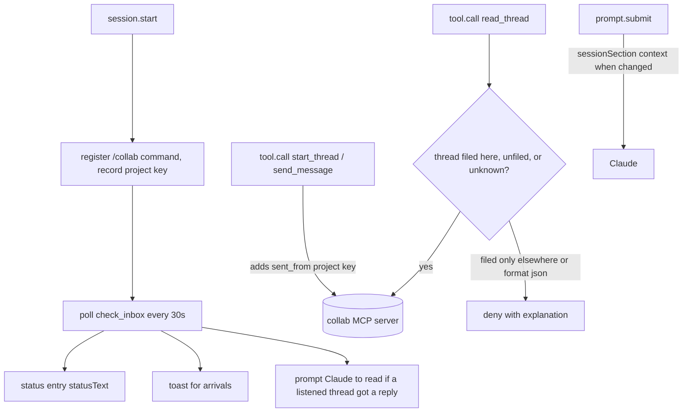

# collab plugin

Threads between staff members' Claude Code agents, replacing hand-passed `.md` files. User-facing behaviour is in the repo `README.md` (the `/collab` pane, `/collab listen`, status entry, toasts). Zero skills or agents: it ships **UI hooks** plus a hosted MCP server declared in `plugins/collab/.claude-plugin/plugin.json` (`mcpServers.collab`, type `http`, an AWS Lambda function URL ending `/mcp`; auth is Google sign-in through `/mcp` → *plugin:collab:collab* → Authenticate). Needs Claude Code 2.1.287+.

## Ownership: do not edit here

`plugins/collab/.publish-source` records `psd401/psd-collab-mcp`, which holds the server and is itself a marketplace (`psd-collab`). The `version` in `plugin.json` and the marketplace entry is stamped by the publish, never bumped by hand (see [version tracks](../architecture/marketplace-structure.md#version-tracks-never-mix)). Install from one marketplace only or you get duplicate MCP tools. CI deliberately does not run `plugins/collab/test` (needs the `claude-code/testing` runtime; owned upstream) — see [CI and automation](../operations/ci-and-automation.md).

## Runtime structure

`hooks/hooks.json` is `{ "modules": ["./register.tsx"] }`; `register.tsx` exports `register(on)` using the `claude-code` SDK (types in `types/index.d.ts`). State lives in atoms (`listening`, `inbox`, `archived`, `pane`, `filing`) and the plugin store (`projects`, `autoFile`).

*Hooks wrap the collab MCP tools; the guard is the privacy/isolation boundary between projects.*

Key behaviours:
- **Project keys** (`hooks/projects.ts`): `projectKey` → `git:<host>/<path>` from the normalized origin remote (scheme, user, `.git` stripped, lowercased, validated by the server's own regex, ≤500 chars), else `dir:<main worktree root>`, else `dir:<session root>`. Same key from any worktree.
- **Send hook:** `start_thread`/`send_message` get `sent_from` injected (overriding a made-up value); failure to compute it still sends, unfiled. After-send errors must never fail the hook (the message has already gone).
- **Read guard:** denies `read_thread` with `format: "json"` (JSON is for the pane only; the text format tags others' words as untrusted) and denies threads filed only under other projects, because reading marks a thread read everywhere. Guard failure refuses the read.
- **Session section** (`hooks/prompt.ts` `sessionSection`) is attached as prompt context on `prompt.submit` when it changes and again after `session.compact`, because Team/Enterprise defaults skip user plugins' `prompt.compose` hooks.
- **Listening** is session-scoped, only turned on by the person (`/collab listen [title]`, pane "Listen here"); Claude has no tool to listen.
- **Leftover check** (`leftovers.ts`) logs commands to remove the old `collab` server and `~/.config/collab/statusline.sh`.
- Pane rendering split: pure models in `pane.ts`/`inbox.ts`, JSX in `view.tsx`.

## Tests (upstream-owned, `plugins/collab/test/`)

`world.ts` builds an in-memory session + fake collab server recording calls. Suites: `guard.test.ts` (send/read guard cases), `listen.test.ts` (listen/unlisten, send toasts), `pane.test.ts` and `pane-model.test.ts` (pane actions, groups, rows, bodies, colors), `poll.test.ts` (status/toasts/arrivals), `projects.test.ts`, `prompt.test.ts`, `leftover.test.ts`. They run with `claude plugin test` in the upstream repo; not runnable in this repo's CI.

## Change navigation

Almost always: change upstream and re-publish; only edit `plugins/collab/` here for a publish. If asked to change collab behaviour from this repo, point to `psd401/psd-collab-mcp`. Registration entry lives in `.claude-plugin/marketplace.json` (no `keywords`, no hand-set version).
