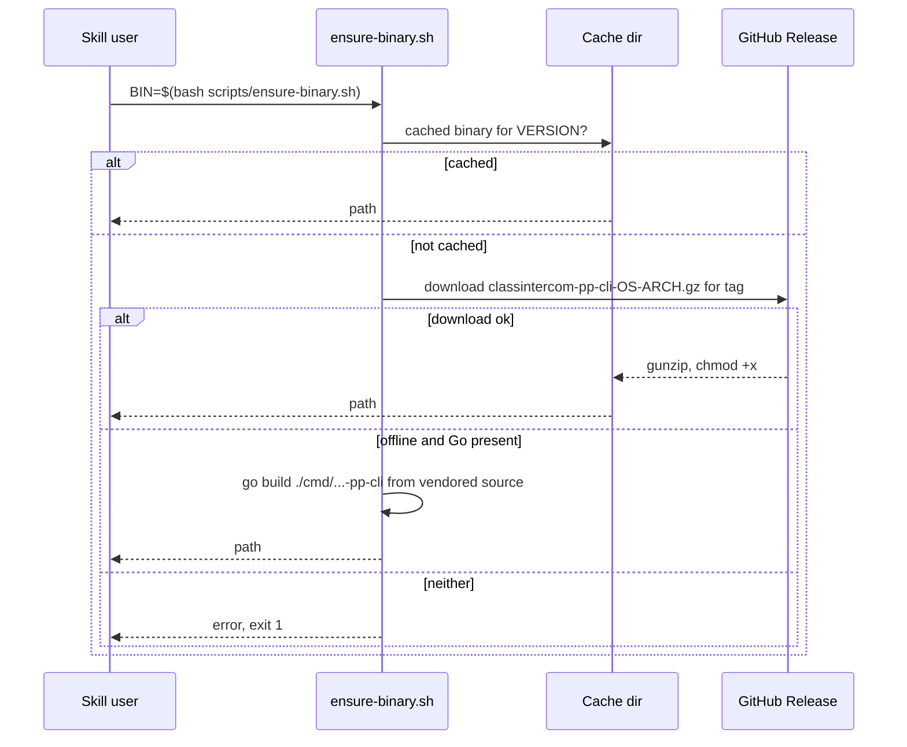

# Vendored Go CLIs: `parentsquare` and `class-intercom`

Two [psd-productivity](../architecture/productivity-plugin.md) skills wrap self-contained Go CLIs generated with [CLI Printing Press](https://github.com/mvanhorn/cli-printing-press) from the live web apps and hand-extended for PSD. Each skill dir contains `SKILL.md` (user surface), `scripts/ensure-binary.sh`, and `cli/` (module `parentsquare-pp-cli` / `classintercom-pp-cli`, Go 1.26, toolchain go1.26.5, cobra command tree).

## Design

- **Read-focused.** ParentSquare: rosters, directories, calendars, notification analytics (district id `998` for PSD), sync/totals/data-health. Class Intercom: content feed, channels, social feed, moderation, reports, tasks. The only write is `create-draft` (`post_create_draft.go`, `create_draft.go`), which hard-forces `state="save_draft"` and is dry-run unless `--confirm`. Never change that to publish/schedule/notify.
- **Auth is the user's browser session**: ParentSquare reads a Chrome cookie via `pycookiecheat` (`auth login --chrome`); Class Intercom uses its own `auth` command.
- **Agent-friendly flags** on every command: `--json`, `--csv`, `--compact`, `--agent`, `--dry-run`, `--select`; framework commands `sync` (local SQLite via `internal/store`), `search`, `doctor`, `which`, `agent-context`. A second binary `*-pp-mcp` exposes the command tree as MCP tools (`internal/mcp/cobratree` walks cobra commands).
- **Generated tree:** per each cli `AGENTS.md`, systemic fixes belong upstream in Printing Press; keep local edits narrow and don't hand-bump `CHANGELOG.md` / `.printing-press-release.json` / `var version`.

## Binary distribution

*Stdout carries only the binary path; diagnostics go to stderr so callers can capture it.*

`ensure-binary.sh` pins `VERSION="v1.0.2"` and `TAG="<name>-cli-${VERSION}"`, caches under `${XDG_CACHE_HOME:-$HOME/.cache}/<name>-pp-cli/<VERSION>/`, maps `uname` to darwin/linux/windows and arm64/amd64. Release workflows (`.github/workflows/classintercom-cli-release.yml`, `parentsquare-cli-release.yml`) fire on tags `classintercom-cli-v*` / `parentsquare-cli-v*` (or manual dispatch with a tag), cross-build darwin/arm64, linux/amd64, windows/amd64 with `CGO_ENABLED=0 -ldflags "-s -w"`, gzip, and `gh release create`. Go dependency caching is deliberately disabled in release builds (cache-poisoning hardening).

## Change navigation

| Intent | Do |
|---|---|
| Ship a CLI change | change `cli/`, push tag `<name>-cli-vX.Y.Z`, then bump `VERSION` in the matching `ensure-binary.sh` to the same version (release must exist first or users fall back to a Go build) |
| Add a command | cobra file under `cli/internal/cli/`, register in `root.go`; keep drafts-only rule; `which_test.go`/`root_test.go` cover registry behavior |
| Change MCP exposure | `cli/internal/mcp/tools.go`, `cobratree/*`; tests `tools_test.go`, `shellout_test.go` |

Focused checks (these are exactly what CI runs, see [CI and automation](../operations/ci-and-automation.md)): `gofmt -l .`, `go vet ./...`, `go test ./...` inside each `cli/` dir. Conditional: a tagged release build only when publishing binaries.
