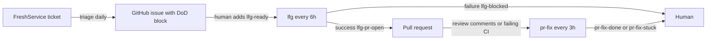

# Cloud routines

Three production routines run on Anthropic's cloud (claude.ai/code/routines), not on a developer machine, replacing a local `/loop`. User-facing guide: `docs/routines/GETTING-STARTED.md` (with infographics `routines-overview.png`, `routines-reference.png`); architecture reference: `routines/README.md`. They form a pipeline over three target repos (`psd401/aistudio`, `psd401/psd-workflow-automation`, `psd401/psd-claude-plugins`).

*Issue → PR → clean PR hand-offs; labels are the state machine.*

| Routine | Cron | Per fire | Output | Labels |
|---|---|---|---|---|
| `triage` | `0 10 * * *` | ≤5 tickets | GitHub issue written to the [issue contract](../workflows/plan-lfg-evolve.md#issue-contract), private-note marker `[claude-routine-triaged]` on the FreshService ticket (idempotency) | `triaged-from-freshservice` |
| `lfg` | `41 */6 * * *` | 1 issue | PR on a `claude/` branch | `lfg-ready` → `lfg-in-progress` → `lfg-pr-open` / `lfg-blocked`; `lfg-skip` opt-out |
| `pr-fix` | `30 */3 * * *` | 1 PR | pushes to the PR's existing branch, replies to comments | `pr-fix-done` / `pr-fix-stuck`; `pr-fix-skip` opt-out |

## Shared environment and bootstrap

All routines share the cloud environment `psd-automation` (`routines/shared/env-setup.sh` installs `gh`; FreshService env vars `FRESHSERVICE_API_KEY`, `FRESHSERVICE_DOMAIN`, `FRESHSERVICE_WORKSPACE_ID` are session env, domain must be network-allowed). Routines **do not load plugins**; only repo-committed skills and `~/.claude/agents|skills` are discovered. So every prompt's Step 1 runs `routines/shared/bootstrap.sh`, which locates the cloned `psd-claude-plugins`, copies `plugins/psd-coding-system/agents/**/*.md` → `~/.claude/agents/` and skills from `psd-coding-system` and `psd-productivity` → `~/.claude/skills/`, and sanity-checks the agents the routines invoke (exit 1 if the repo isn't found). Single source of truth stays `plugins/**`; see [coding system](../architecture/coding-system.md). Staggered minutes (`:41` vs `:30`) keep lfg and pr-fix from starting together.

## Per-routine notes

### triage
Reads the software-development workspace (do **not** combine `workspace_id` with the `new_and_my_open` filter, which silently ignores the workspace), classifies the target repo (default `aistudio` with a "Routing uncertainty" note), fans out diagnosis agents, detects fixes touching protected paths (Step 5.5), files the issue, updates FreshService. Never modifies code or opens PRs.

### lfg
Runs `/lfg` phases 3–7 headlessly ([the interactive skill](../workflows/plan-lfg-evolve.md#lfg-phases)). Claims the issue by swapping labels, works in a clone, escalates by `lfg-blocked` + comment instead of deferring. Humans retry by removing `lfg-blocked` and re-adding `lfg-ready`. Captures learnings at Step 13.

### pr-fix
Same watch-until-clean machinery as `/lfg` Phase 8, with round markers `<!-- review-pr:round:N:timestamp:T:sha:S -->` so interactive `/lfg` and the routine can interleave without re-processing comments. Needs "Allow unrestricted branch pushes: YES" (pushes to arbitrary PR branches; lfg must be NO). It never opens PRs or merges. Per its prompt, `pr-fix-done` is dropped when new activity arrives and absence of the label makes a PR eligible again.

## Protected paths

Autonomous sessions cannot answer permission prompts, so editing these stalls the run: `.claude/settings*.json`, `.claude/hooks|agents|skills/**`, `.mcp.json`, `.devcontainer/**`, `.github/workflows/**`, `**/claude*.json`, `**/.claude*`, `**/hooks.json`. lfg blocks out immediately; pr-fix labels `pr-fix-stuck`; triage flags it in the issue.

## Change navigation

- Edit `routines/<name>/routine-prompt.md` (or `shared/*.sh`), commit, then **manually paste into the web UI** — the cloud does not watch the repo. Cron changes via `/schedule update`.
- Changing an agent or skill affects routines on their next fire (always pulls `main`). Test with `/lfg`/`/plan` interactively before merging; pin to a tag if this proves risky.
- New label: add to the routine prompt's state machine table, its README `gh label create` loop for all three repos, and `docs/routines/GETTING-STARTED.md` / infographic if user-facing.
- No automated tests; the first-run checklists in each routine README (run now on a throwaway issue/PR) are the validation path.
