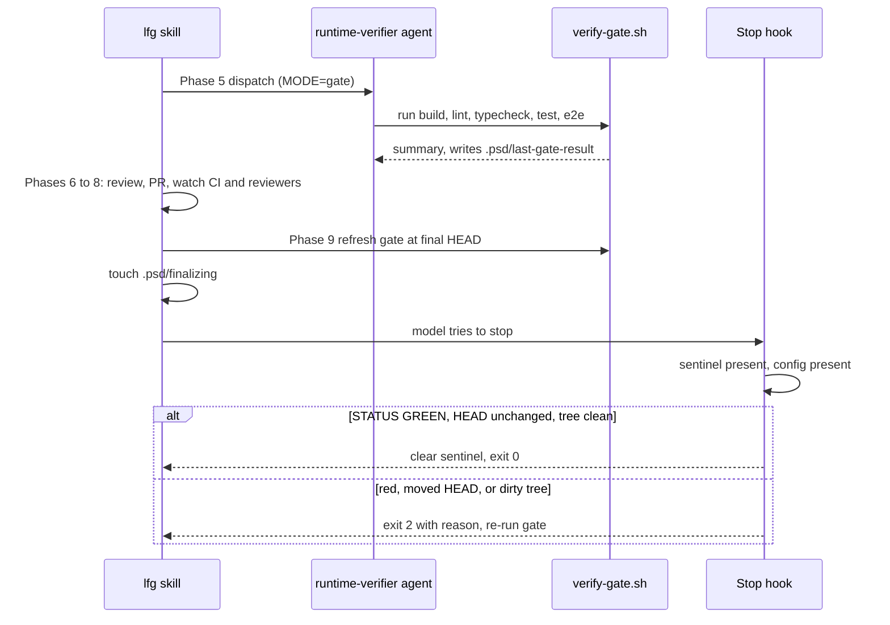

# Definition-of-Done verify gate

"Done" for the [coding-system](../architecture/coding-system.md) means the gate is green for the **whole app**, not just touched files. The contract is `plugins/psd-coding-system/docs/patterns/definition-of-done.md`; the issue-side input is the DoD block in the [issue contract](./plan-lfg-evolve.md#issue-contract).

## Pieces

- **`.psd/verify.json`** — per-project config written by `/setup` (`plugins/psd-coding-system/skills/setup/SKILL.md`; `show`/`reset` arguments). Keys: `commands{build,lint,typecheck,test,e2e}`, `e2e_required`, `e2e_flows`, `strictness` (`block`|`warn`), `reviewers` (AI reviewer logins for the watch loop), `commit_learnings`, `auto_worktree`, `screenshot_dir`, `baseline.allow_preexisting_failures`, and `review_agents{alwaysOn,languageReviewers,contextTriggered}`. `/setup` auto-detects commands from `package.json`, pyproject, Cargo, go.mod and proposes zero-warning lint forms.
- **`scripts/verify-gate.sh`** — runs build → lint → typecheck → test → e2e in order via `run_step`, `eval`-ing each configured command (unset commands are skipped). `e2e` is required only when `e2e_required` is true. Override the config path with `PSD_VERIFY_CONFIG`.
- **`scripts/verify-gate-stop-hook.sh`** — Stop-hook backstop registered in `hooks/hooks.json` (30 s timeout).
- **Cache** `.psd/last-gate-result` (`STATUS`, `HEAD`, `DIRTY`) written by `write_result` after every run.
- **Sentinel** `.psd/finalizing`, touched by `/lfg` Phase 9 only after the PR is clean.

## Exit codes and states

`verify-gate.sh`: exit 0 when green, when no config exists (inert), when `jq` is missing (treated inert), or when `strictness=warn`; exit 1 only for red with `strictness=block`. Stop hook: exit 0 allows stop, exit 2 blocks and feeds stderr to the model.

*The Stop hook is a cheap verifier of a cached result, armed only at finalize so it cannot fight mid-implementation turns or the PR polling waits.*

## Behavioural test matrix (no automated tests exist; verify manually in a scratch repo)

| Case | Expected |
|---|---|
| No `.psd/verify.json` | gate prints "inert", exit 0; Stop hook exit 0 |
| Sentinel absent | Stop hook exit 0 regardless of result file |
| Sentinel older than 30 min | hook deletes it, exit 0 |
| No result file / `STATUS=RED` | exit 2 with reason |
| New commit or edit after green gate | exit 2 ("HEAD moved" / "Uncommitted changes") |
| `strictness=warn`, failing step | summary RED, exit 0, result still written as RED |
| Optional e2e failing, `e2e_required` false | warning only, summary GREEN |

## Change navigation

- **Add a config key:** update the schema table in `docs/patterns/definition-of-done.md`, the JSON template in `skills/setup/SKILL.md`, and the reader (`jq` in `verify-gate.sh` or the consumer such as `/lfg`, which reads `auto_worktree`, `commit_learnings`, `screenshot_dir`, `reviewers`, `review_agents`).
- **Add a gate step:** add a `run_step` call in order and mention it in the DoD doc and `runtime-verifier` agent.
- **Keep it deterministic:** do not make the Stop hook run tests (it would hang the UI); do not add TS per-edit checks to `post-edit-validate.sh` — the gate owns typechecking.
- Related: [/lfg loop](./plan-lfg-evolve.md), the PostToolUse hooks in [coding-system](../architecture/coding-system.md#hooks).
- Conditional broader check: run the gate end-to-end in a scratch repo only if you change exit-code or cache semantics.
