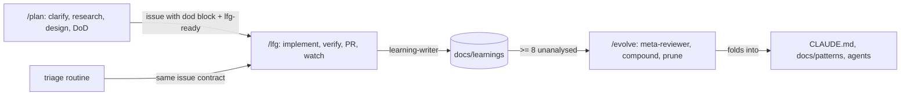

# `/plan` → `/lfg` → `/evolve`

Three skills of the [coding-system](../architecture/coding-system.md) form a loop: **plan** the work and define "done", **build** it autonomously to a clean PR, then **compound** what was learned back into durable docs.

*Issue contract is the interface between planning surfaces and the build loop.*

## /plan

Phases: clarify (ask only design-changing questions; refine an existing issue number via `gh issue view`), size (small/medium/large), parallel research via Task, design + DoD, emit. Emits either contract-compliant GitHub issues (`gh issue create ... --label lfg-ready`) or a hand-off to `/lfg`. Runs forked as `general-purpose` on `claude-fable-5-1`/`xhigh`; optional `plan-validator` pass.

## Issue contract

Canonical: `plugins/psd-coding-system/docs/patterns/issue-contract.md`. Body sections: Summary, **Definition of Done** wrapped in `<!-- dod:start -->…<!-- dod:end -->`, Acceptance tests / E2E flows, Affected areas. Producers: `/plan` and the [triage routine](../operations/cloud-routines.md#triage). Consumer: `/lfg` extracts the block verbatim as its loop-exit condition; if absent it derives a DoD from the canonical list plus `.psd/verify.json` (see [gate](./definition-of-done-gate.md)).

## /lfg phases

1. Load the DoD (issue number → `gh issue view`; otherwise quick-fix text).
2. Branch: by default an isolated **worktree** `.claude/worktrees/<branch>` based on `dev` if it exists on origin else the default branch (branch `feature/<N>-<slug>` or `fix/<slug>`), entered with `EnterWorktree`; `auto_worktree:false` or already-in-worktree branches in place. A fresh worktree needs dependencies installed; the `WorktreeCreate` hook symlinks `.env`.
3. Research: `work-researcher`.
4. Implement with TDD and atomic commits.
5. Verify loop: dispatch `runtime-verifier` (`MODE=gate`) until PASS; confirms `.psd/last-gate-result` is GREEN.
6. Self-review: one parallel round of the configured review agents (always-on, language, context-triggered by changed paths); fix all findings; re-run Phase 5.
7. Open PR. Screenshots are **committed** to `screenshot_dir` and referenced with SHA-pinned `github.com/<repo>/blob/<sha>/<path>?raw=true` URLs; never claim evidence without an image link (use `N/A — no UI surface`).
8. Watch-until-clean (cap 10 rounds): `gh pr checks --watch`, poll reviews with the Monitor tool until every login in `reviewers` posts, categorize comments (actionable / discussion / addressed / stylistic), fix, re-run Phase 5, loop. Reuses the machinery of `routines/pr-fix/routine-prompt.md` and its round-marker comments, so interactive and [routine](../operations/cloud-routines.md#pr-fix) runs can interleave. After 10 rounds, escalate with AskUserQuestion.
9. Finalize: refresh gate, dispatch `learning-writer`, commit learnings if `commit_learnings`, touch `.psd/finalizing`.

"No deferral" is a hard rule: no TODOs/follow-up issues and no `eslint-disable`/`noqa`/`@ts-ignore` suppressions, except genuinely external blockers (ask the user).

## Learnings and /evolve

- **Storage:** repo-root `docs/learnings/{category}/{date}-{slug}.md` is canonical (committed here; examples under `docs/learnings/`). The plugin-internal `plugins/psd-coding-system/docs/learnings/` is gitignored. Agent memory is local in `.claude/agent-memory/`. No telemetry.
- **Evolve state:** `docs/learnings/.evolve-state.json` (`last_analyze`, `last_updates_check`, `last_compare`, `last_concepts`, `learnings_at_last_analyze`). It is also listed in `.gitignore` under the plugin path, but a root copy is tracked.
- **Decision ladder** (first match wins): (1) ≥8 new learnings → `meta-reviewer` analysis, then *compound* insights into `CLAUDE.md`/`docs/patterns`/agents and `git rm` the compounded learnings; (2) release-gap analysis against the Claude Code changelog (>30 days); (3) contribute `applicable_to: universal` learnings to patterns; (4) plugin comparison (>30 days); (5) automation-concepts extraction; (6) health dashboard. A 90-day TTL deletes stragglers; a skill-drift check flags SKILL.md files with >5 deferral phrases.
- Phase 0 warns when the installed plugin cache version differs from the repo version.

## Related skills

`/worktree` (`docs/patterns/worktrees-explained.md`, `clean` prunes merged branches and worktrees), `/setup`, `/bump-version` ([release](../architecture/marketplace-structure.md#version-tracks-never-mix)).

## Change navigation

| Intent | Start | Check |
|---|---|---|
| Change what "done" means | `docs/patterns/definition-of-done.md`, `scripts/verify-gate.sh` | [gate matrix](./definition-of-done-gate.md#behavioural-test-matrix-no-automated-tests-exist-verify-manually-in-a-scratch-repo) |
| Change issue shape | `docs/patterns/issue-contract.md`, then `/plan` Phase 5 and `routines/triage/routine-prompt.md` (both emit it) and `/lfg` Phase 1 (parses it) | read all four |
| Change reviewer set | `/lfg` Phase 6, `/setup` `review_agents`, `docs/agent-manifest.md` | `claude plugin validate .` |
| Change watch loop | `/lfg` Phase 8 **and** `routines/pr-fix/routine-prompt.md` (shared marker format) | — |
